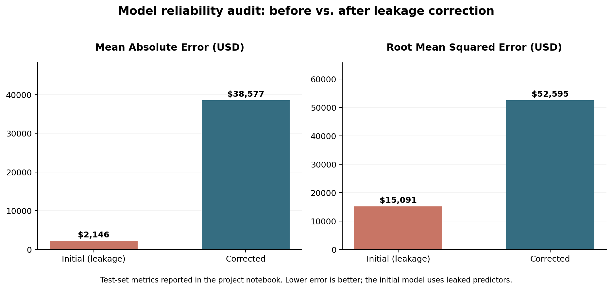
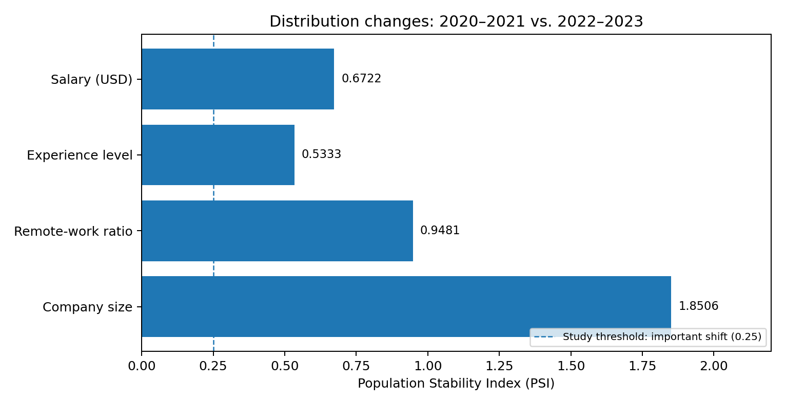
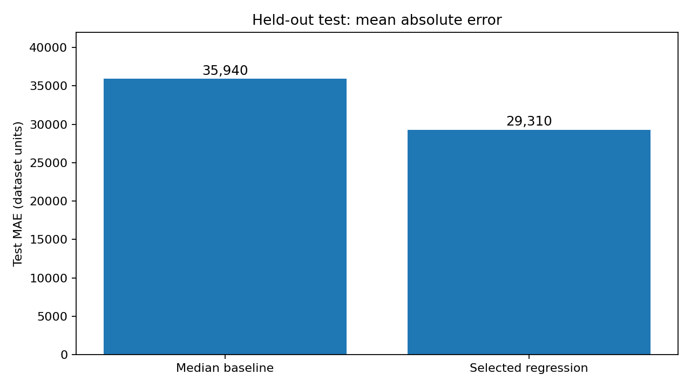

# Data Science & Machine Learning | Project Portfolio

**Python · Data Analysis · Predictive Modeling · Machine Learning · Data Quality**

I'm **Franco Curcho**, a Biomedical Engineer pursuing advanced studies in **Artificial Intelligence at the University of Buenos Aires (UBA)**. I develop data-driven solutions with Python, combining engineering problem-solving with sound statistical evaluation and clear communication.

This portfolio brings together hands-on academic projects in data analysis, machine learning, explainable AI, and data quality. Each project focuses on the **problem, approach, results, and limitations**—not just the code.

> **Open to freelance collaborations:** Python data processing, exploratory analysis, repeatable data workflows, predictive modeling, and model auditing.

## How I Can Help

| Service | Example deliverables |
| --- | --- |
| **Data cleaning & analysis** | Cleaned CSV/Excel files, validation checks, visualizations, and analytical summaries |
| **Python data workflows** | Reusable data transformation, validation, and reporting scripts |
| **Machine learning** | Classification/regression experiments, baselines, model comparisons, and evaluation reports |
| **Data quality & monitoring** | Missing-value checks, distribution-shift analysis, anomaly investigation |
| **Model auditing** | Data leakage detection, explainability, and subgroup performance analysis |

These are areas I can work in; the projects below are **academic work, not past client engagements**.

## Featured Projects

### 01 · Salary Prediction — Explainability & Data Leakage Detection

[**Explore project**](./01-model-interpretability/README.md) · [View notebook](./01-model-interpretability/Actividad_1_Interpretabilidad_Modelos.ipynb)

**Challenge:** An apparently accurate salary prediction model can be misleading if its inputs include information unavailable at prediction time.

**Approach:** Data inspection, Random Forest regression, permutation feature importance, SHAP explanations, and retraining after removing salary-related leakage variables.

| Metric | Original model | Leakage-corrected model |
| --- | ---: | ---: |
| R² | **0.948** | **0.368** |
| MAE | $2,146 | $38,577 |
| RMSE | $15,091 | $52,595 |



**Takeaway:** Removing leaking features dramatically reduces the reported model performance. Reliable evaluation matters more than an impressive but misleading score.

`Python` · `Pandas` · `Scikit-learn` · `SHAP` · `Model Evaluation`

---

### 02 · Data Quality, Distribution Shift & Anomaly Detection

[**Explore project**](./02-data-quality-monitoring/README.md) · [View notebook](./02-data-quality-monitoring/Actividad_2_Calidad_Drift_Anomalias.ipynb)

**Challenge:** Missing data, shifting distributions, and unusual records can affect the reliability of analytics and machine-learning systems.

**Approach:** Completeness and validity checks, Population Stability Index (PSI), Isolation Forest, Local Outlier Factor (LOF), and interpretation of flagged observations.



**Takeaway:** Demonstrates a structured process for monitoring datasets and investigating unusual observations without assuming every outlier is an error.

`Data Validation` · `PSI` · `Isolation Forest` · `LOF` · `Python`

---

### 03 · Communities and Crime — Exploratory Data Analysis

[**Explore project**](./03-communities-crime-eda/README.md) · [View notebook](./03-communities-crime-eda/Actividad_3_Communities_Crime.ipynb)

**Challenge:** Understand the distributions, data limitations, and relationships in socioeconomic and crime-related indicators.

**Approach:** Data preparation, descriptive statistics, distribution analysis, and visual exploration.

**Takeaway:** Illustrates how to transform a complex raw dataset into an interpretable exploratory study. Relationships found in observational data should not be interpreted as causal effects.

`Exploratory Data Analysis` · `Pandas` · `Statistics` · `Visualization`

---

### 04 · Income Prediction — Regression, Validation & Model Auditing

[**Explore project**](./04-income-prediction-audit/README.md) · [View notebook](./04-income-prediction-audit/Actividad_4_Ingresos_Leakage_Sesgos.ipynb)

**Challenge:** Build a regression model with defensible validation while evaluating more than overall predictive accuracy.

**Approach:** Missing-value imputation, Scikit-learn pipelines, target transformations, group-aware data splitting, cross-validation, baseline comparison, and subgroup error analysis.

| Model | Test MAE |
| --- | ---: |
| Median baseline | 35,940 |
| Selected regression model | **29,310** |



**Takeaway:** The selected model improves test MAE relative to the median baseline. The notebook also examines limitations and differences in prediction errors across demographic groups.

`Regression` · `Cross-Validation` · `Pipelines` · `Leakage Prevention` · `Model Auditing`

## Technical Toolkit

| Area | Tools and methods |
| --- | --- |
| **Programming** | Python, SQL |
| **Data analysis** | Pandas, NumPy, Matplotlib, Seaborn |
| **Machine learning** | Scikit-learn, regression, classification, Random Forest |
| **Interpretability** | SHAP, permutation feature importance |
| **Data quality** | Missing-value analysis, PSI, Isolation Forest, LOF |
| **Development** | Jupyter Notebook, Git, GitHub |

## Repository Structure

```text
Data-Science---Machine-Learning--/
├── README.md
├── 01-model-interpretability/
│   ├── README.md
│   ├── Actividad_1_Interpretabilidad_Modelos.ipynb
│   ├── ds_salaries.csv
│   └── assets/model_comparison.png
├── 02-data-quality-monitoring/
│   ├── README.md
│   ├── Actividad_2_Calidad_Drift_Anomalias.ipynb
│   ├── ds_salaries.csv
│   └── assets/psi_comparison.png
├── 03-communities-crime-eda/
│   ├── README.md
│   ├── Actividad_3_Communities_Crime.ipynb
│   ├── communities.data
│   └── communities.names
└── 04-income-prediction-audit/
    ├── README.md
    ├── Actividad_4_Ingresos_Leakage_Sesgos.ipynb
    ├── census_income.xlsx
    └── tp4_test_mae.png
```

## Getting Started

Clone the repository:

```bash
git clone https://github.com/FrancoCurcho/Data-Science---Machine-Learning--.git
cd Data-Science---Machine-Learning--
```

Create and activate a virtual environment:

```bash
python -m venv .venv
source .venv/bin/activate
```

On Windows PowerShell, activate with `.venv\Scripts\Activate.ps1` instead.

Install the main packages used in the notebooks:

```bash
python -m pip install numpy pandas matplotlib seaborn scikit-learn shap jupyter openpyxl threadpoolctl
```

Launch Jupyter:

```bash
jupyter notebook
```

Open each notebook from its own project folder so its relative data paths can resolve.

**Reproducibility note:** Package versions have not yet been pinned, and a complete clean-environment execution test has not been performed. Individual notebooks may need environment-specific adjustments; inspect their initial cells for data-path and package assumptions.

## About the Results

These projects were developed in an **academic learning context**. Reported metrics describe the specific datasets and experimental configurations in the notebooks; they are not guarantees of performance on new datasets.

I prioritize clear assumptions, reliable validation, readable code, and honest interpretation of results.

## Let's Collaborate

I am interested in freelance projects and collaborations involving Python data processing, exploratory data analysis, workflow automation, predictive modeling, and machine-learning evaluation.

**GitHub:** [FrancoCurcho](https://github.com/FrancoCurcho)

---

*Reliable analysis starts with trustworthy data, clear assumptions, and measurable results.*

